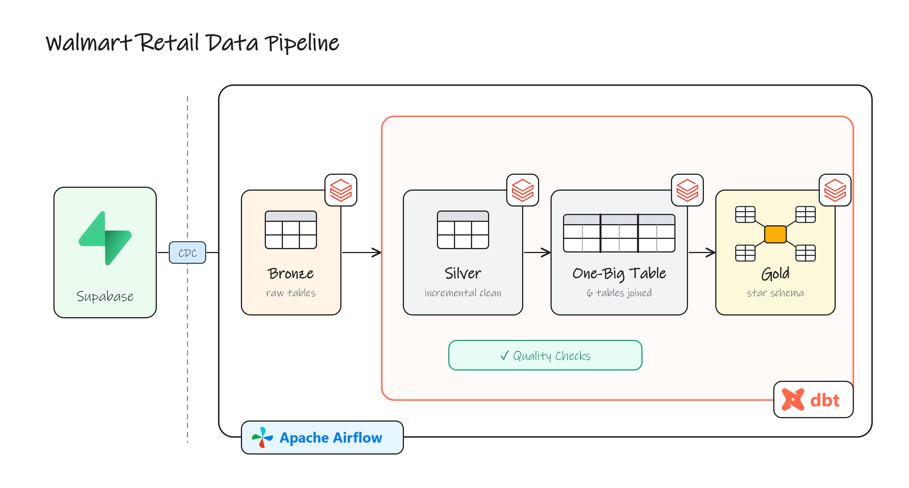

# Walmart Retail Data Pipeline

A portfolio project: an end-to-end ELT pipeline that moves Walmart retail data from an
operational Supabase database into an analytics-ready star schema on Databricks. dbt handles
the transformations and Apache Airflow orchestrates the whole run.



## How it works

| Layer | What happens | Tool |
|---|---|---|
| **Source** | Operational data lives in Supabase (Postgres) | Supabase |
| **Bronze** | A Databricks Job ingests the source tables via CDC into `walmart.bronze` | Databricks |
| **Silver (technical)** | Each table is loaded incrementally (MERGE on its primary key, watermark on `updated_timestamp`) | dbt |
| **Silver (business)** | All six tables are joined into a single One-Big Table, `obt_b` | dbt |
| **Gold** | A star schema: `fact_orders` plus SCD Type 2 dimensions built with `dbt snapshot` | dbt |

Source tables: `orders`, `order_items`, `customers`, `products`, `stores`, `employees`.

### Orchestration

The Airflow DAG `orchestrate` runs every step in order:

```
ingest_cdc → clean_target → source_freshness
  → silver_technical → silver_technical_tests
  → silver_business  → silver_business_tests
  → gold_ephemeral   → gold_dimensions (snapshots) → gold_facts
```

`ingest_cdc` triggers the Databricks Job through `databricks-sdk` and waits for it to
finish. If the job does not succeed, the DAG stops before any dbt step runs.

### Data quality

- `not_null` and `unique` tests on the silver models (`silver_t/properties.yaml`)
- A custom test on `obt_b` that warns when any join key is null (`tests/test_obt.sql`)
- `dbt source freshness` on the bronze sources before transforming

## Tech stack

- **Apache Airflow 3** with CeleryExecutor, PostgreSQL, and Redis, run on Docker Compose
- **dbt-core** + **dbt-databricks**
- **Databricks** (Unity Catalog `walmart`, SQL Warehouse)
- **Supabase** as the source database
