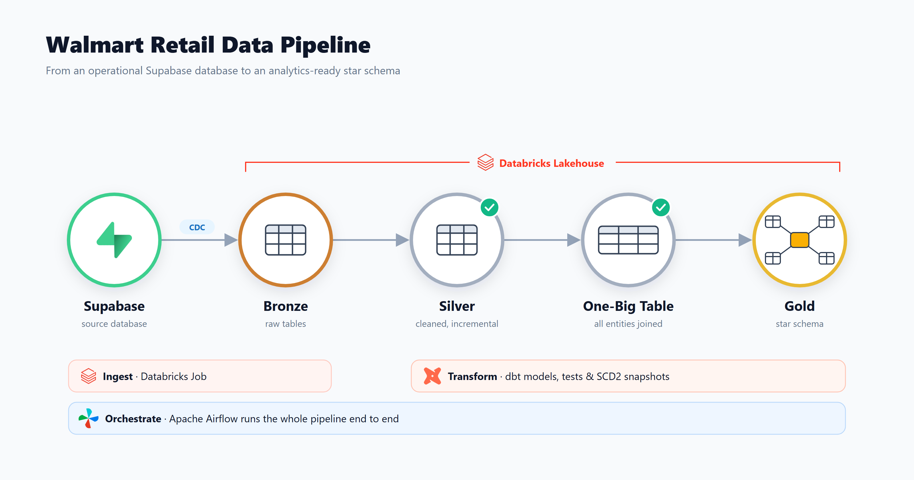

# Walmart Retail Data Pipeline

A portfolio project: an end-to-end ELT pipeline that moves Walmart retail data from an
operational Supabase database into an analytics-ready star schema on Databricks. dbt handles
the transformations and Apache Airflow orchestrates the whole run.



## How it works

| Layer | What happens | Tool |
|---|---|---|
| **Source** | Operational data lives in Supabase (Postgres) | Supabase |
| **Bronze** | A Databricks Job ingests the source tables via CDC into `walmart.bronze` | Databricks |
| **Silver (technical)** | Each table is loaded incrementally (MERGE on its primary key, watermark on `updated_timestamp`) | dbt |
| **Silver (business)** | All six tables are joined into a single One-Big Table, `obt_b` | dbt |
| **Gold** | A star schema: `fact_orders` plus SCD Type 2 dimensions built with `dbt snapshot` | dbt |

Source tables: `orders`, `order_items`, `customers`, `products`, `stores`, `employees`.

### Orchestration

The Airflow DAG `orchestrate` runs every step in order:

```
ingest_cdc → clean_target → source_freshness
  → silver_technical → silver_technical_tests
  → silver_business  → silver_business_tests
  → gold_ephemeral   → gold_dimensions (snapshots) → gold_facts
```

`ingest_cdc` triggers the Databricks Job through `databricks-sdk` and waits for it to
finish. If the job does not succeed, the DAG stops before any dbt step runs.

### Data quality

- `not_null` and `unique` tests on the silver models (`silver_t/properties.yaml`)
- A custom test on `obt_b` that warns when any join key is null (`tests/test_obt.sql`)
- `dbt source freshness` on the bronze sources before transforming

## Tech stack

- **Apache Airflow 3** with CeleryExecutor, PostgreSQL, and Redis, run on Docker Compose
- **dbt-core** + **dbt-databricks**
- **Databricks** (Unity Catalog `walmart`, SQL Warehouse)
- **Supabase** as the source database

## Project structure

```
.
├── dags/
│   └── orchestrate.py          # Airflow DAG
├── walmart_project/            # dbt project
│   ├── models/
│   │   ├── source/             # bronze source definitions
│   │   ├── silver_t/           # incremental technical layer + tests
│   │   ├── silver_b/           # One-Big Table (obt_b)
│   │   └── gold/
│   │       ├── ephemeral/      # eph_* models feeding the snapshots
│   │       └── fact/           # fact_orders
│   ├── snapshots/              # SCD Type 2 dimensions (dim_*)
│   ├── macros/                 # custom schema naming
│   ├── tests/                  # custom data tests
│   ├── dbt_project.yml
│   └── profiles.yml            # reads credentials from env vars
├── docker-compose.yaml
├── Dockerfile
└── requirements.txt
```

## Getting started

**Prerequisites:** Docker, a Databricks workspace with a SQL Warehouse, and a Databricks
Job that ingests the Supabase tables into `walmart.bronze`.

1. Copy `.env.example` to `.env`.
2. Fill in strong local values for the Airflow and PostgreSQL secrets, plus
   `DATABRICKS_HOST`, `DATABRICKS_TOKEN`, and `DATABRICKS_JOB_ID`.
3. Update `http_path` in `walmart_project/profiles.yml` to point to your own SQL Warehouse.
4. Start the stack:

   ```bash
   docker compose up --build
   ```

5. Open the Airflow UI at http://localhost:8080 and trigger the `orchestrate` DAG.
   The Celery monitor, Flower, is at http://localhost:5555 if you start it.

To run dbt by hand, go to `walmart_project/` and run commands from there, for example
`dbt run --select silver_t` or `dbt snapshot`.

## Security notes

- `.env` is ignored by Git. Keep credentials out of DAGs, dbt profiles, and committed config.
- The dbt profile and the DAG read their Databricks settings from environment variables.
- Use URL-safe characters for the PostgreSQL password, because it is also part of
  Airflow's database connection URL.
